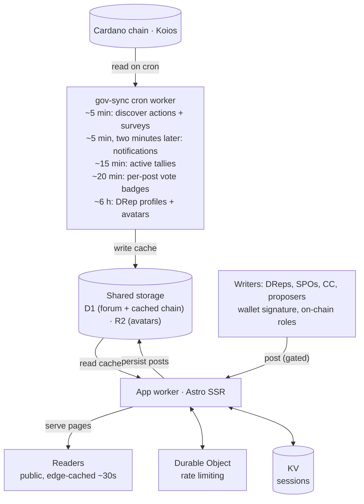

<p align="center">
  
</p>

<h1 align="center">DRepTalk</h1>

<p align="center">
  <a href="https://github.com/katomm/dreptalk.com/actions/workflows/ci.yml"></a>
  <a href="https://biomejs.dev"></a>
  <a href="LICENSE"></a>
  <a href="https://dreptalk.com"></a>
  <a href="https://preprod.dreptalk.com"></a>
</p>

The public deliberation layer for Cardano governance, wallet-authenticated, running at [dreptalk.com](https://dreptalk.com).

Incoming on-chain Governance Actions automatically open a thread, and DReps, SPOs, CC members, and proposers discuss them next to the live on-chain vote data. Reading is public. Writing is gated to those on-chain roles, each proven by a wallet signature (no custody of keys, signature-based login). Delegators can sign in too, to follow their DRep and receive notifications, but they cannot post.

The aim is a place where Cardano governance is discussed, voted, and explained, next to the on-chain data it is about.

## What is on the site

- **Governance actions.** A thread per on-chain action with the DRep, SPO and committee tallies, the vote rationales behind them, and a voting flow for DReps signing in their own wallet.
- **CIP-179 surveys.** Surveys published on chain under metadata label 17 are mirrored from [Tessera](https://github.com/mpizenberg/cardano-tessera) when a governance action links one, and a DRep can answer from the thread with the wallet they signed in with. An answer is survey metadata and not a vote, so the card shows an informational tally under a stated counting rule, never a result.
- **DRep groups.** Group events published under metadata label 8416 are ingested on preprod. Group pages at `/groups`, group chips on DRep profiles and a group filter on the DRep list read from them. DReps found groups at `/groups/new`, join and leave them, and manage them together through shared signing links (see below).
- **Analytics.** A public dashboard at `/analytics` on vote concentration, committee and SPO participation, throughput and timing, the weight parked on the two default delegation options, and a report card per DRep.
- **Governance Review.** A written edition per epoch window at `/governance-review`: what was decided, what moved, what is still open. Signed-in readers get a browser push or Telegram message when a new edition is out. Mainnet only.
- **Treasury.** Enacted withdrawals tracked against the Net Change Limit of each budget period at `/treasury`.
- **For delegators.** A delegation dashboard at `/my-drep` reading the DRep's record since the day you delegated, a matching quiz at `/match`, and notifications by browser push or Telegram.

## Submitting a governance action

A submit page at `/ga/new` builds and submits new governance actions: an information action, a motion of no confidence, a hard fork initiation, a new constitution, a committee update, and a treasury withdrawal, which the constitution's guardrails script checks before the wallet signs. It builds the CIP-108 metadata, pins it to IPFS, and the connected wallet builds, signs and submits the proposal transaction in the browser. The form can be drafted and reviewed, with a Proposal Draft linked in, before a wallet is connected. Signing happens from that review, so every action is seen as it will be published before the wallet opens, and dreptalk.com never handles keys.

## Managing DRep groups

On preprod, a signed-in key DRep founds a group alone or together with other DReps, and members join, leave, approve requests, change the management policy, edit the profile and dissolve the group from the group page. Every group transaction is built in the browser and paid by the initiator's wallet. When it needs more than one signature, it is stored with a shareable signing link at `/groups/sign/<id>`, where the other signers add their witnesses and anyone who may sign submits it. The server decodes every stored transaction and accepts it only when its events equal the declared action, and checks it against the current group state before storing and before submit. Each transaction is valid for 48 hours. The user guide is at `/help/drep-groups`.

Storage, all in D1 and created by `migrations/0126_drep_group_actions.sql`:

- `pending_multisig_tx` carries group transactions next to multisig votes, with the required signers, the initiator's fee inputs (transaction hash and index, so a cancelled action can be made unusable for good by spending them), the validity end and how the action was resolved. Group rows are kept as the record of each action.
- `drep_group_profile_docs` holds the group profile documents DRepTalk hosts at `/group-profile/<hash>.json`, content addressed.
- `drep_group_own_outcomes` records the verdict of every event of a tracked transaction, `drep_group_policy_keys` maps admin keys to policy scripts, `drep_group_anchor_refs` records which stored transactions reference a profile document, and `drep_group_join_notify` queues permissioned join requests for the admins' notification.

The `drep-groups` phase of the governance run resolves submitted actions from those verdicts, marks actions that can never reach the chain, and sends join request notifications. The 6-hourly run deletes hosted profile documents that were never anchored on chain, once no stored transaction and no open action references them and a 7 day grace has passed. Two notification types, `group_join_request` and `group_signature_request`, share one preference, DRep groups, on by default.

## Quickstart

Requires Node 24+. Local and preview run against the Cardano preprod testnet, set `CARDANO_NETWORK=preprod` in `.dev.vars`.

```sh
cp .dev.vars.example .dev.vars   # preprod, every optional variable listed and commented out
npm install
npm run db:migrate:local   # set up the local database, required once before the first dev run
npm run db:seed:local      # optional: fake forum data (users, threads, governance actions) to click around
npm run dev                # app dev server (Astro, with HMR)
```

For the full local setup, the database, and running governance syncs by hand, see [docs/development.md](docs/development.md). For shipping to mainnet and preprod, see [docs/deployment.md](docs/deployment.md).

## End-to-end tests

The browser tests in `e2e/` click through sign-in, delegation and governance action submission with [cip30-test-wallet](https://github.com/Lichtstaub/cip30-test-wallet), a headless CIP-30 wallet injected into the page.

The default run needs no wallet funds and touches no chain. The dev server reads Koios from a local fixture server (`e2e/koios-fixture/`), and the wallet simulates every submit. CI runs it on every pull request.

```sh
cp e2e/dev.vars.example .dev.vars   # preprod, plus the fixture server and a placeholder pinning token
npm run db:migrate:local
npm run db:seed:local && npm run db:seed:e2e
npx playwright install chromium
npm run test:e2e
```

Two more tiers run against preprod and are never part of CI. Both need `PREPROD_TEST_WALLET_MNEMONIC`, the mnemonic of a testnet wallet whose account 0 is a registered preprod DRep, and a `.dev.vars` without `KOIOS_BASE_URL`:

- `DREPTALK_E2E_CHAIN=read npm run test:e2e` runs the specs in `e2e/tests/chain/` that only read from preprod, such as a real DRep sign-in.
- `DREPTALK_E2E_CHAIN=write` is for specs that submit real transactions and pay real deposits. It takes exactly one spec file on the command line.

Notes for local runs:

- `astro dev` starts itself in the background when it detects a coding agent (`CLAUDECODE` or `AI_AGENT` in the environment), and Playwright then never sees it come up. Run the tests as `env -u CLAUDECODE -u AI_AGENT npm run test:e2e` from such a shell.
- Running `astro check` while the dev server runs from the same folder invalidates Vite's prebundled dependencies. Pages then stop hydrating and the wallet looks missing. Delete `node_modules/.vite` and start again.

## Contributing

Contributions are welcome. See [CONTRIBUTING.md](CONTRIBUTING.md) for the workflow, code style, and commit and pull request conventions.

## Security

Found a vulnerability? Please report it privately, not in a public issue. See [SECURITY.md](SECURITY.md).

## Stack

Astro (SSR) on Cloudflare Workers, with D1, KV, R2 and Cloudflare Images for self-hosted DRep avatars, and a Durable Object for atomic rate limiting. A standalone cron worker ingests governance actions, mirrors CIP-179 surveys, and dispatches notifications (browser push and Telegram). A third small worker serves [drep.link](https://drep.link), short links that redirect to DRep profiles. Chain data via Koios, used anonymously by default, set `KOIOS_API_KEY` for higher rate limits. Survey data via a Tessera backend, one per network, switched on by `TESSERA_BACKEND_URL`. A free [koios.rest](https://koios.rest) account is enough to run everything, though a Pro key is recommended for production to keep the heavy first DRep sync comfortably inside the rate limit. Defaults to mainnet, set `CARDANO_NETWORK=preprod` for local and preview.

The chain is never read live on a page request. The cron worker pulls from Koios on a schedule and writes the result to shared storage. The app worker only ever reads that cache, so every on-chain value is shown with an "as of" time.



Moderation is community-first: any on-chain writer (DRep, SPO, CC member, or proposer) can flag a post, and a post is hidden behind a placeholder once three distinct writers have flagged it. Every writer is a wallet-verified governance participant, and registering as a DRep locks a refundable 500 ada deposit, so coordinated abuse is expensive and this lightweight check is expected to be enough in early operation. The post author and moderators can still read a hidden post. Moderators and admins can be granted by stake address through the `MODERATORS` env value (comma-separated `stakeAddress` or `stakeAddress:role`, role `admin` or `moderator`), empty by default: they sign in with the normal stake-key wallet flow, and the allowlist only adds the moderation role.

On-chain values (governance tallies and status, DRep profiles, per-post vote badges) are synced on crons and are cached, not live, and every place they appear shows an "as of" time. The exact cadences live in one place, `src/lib/freshness.ts`, and are published at `/help/data-freshness`.

DRepTalk ships an imprint and privacy page (`/imprint`, `/privacy`), the operator disclosure that German and EU law require for a public site. The policy text is public and lives in the repo, and the operator's own details are injected from `LEGAL_*` env vars so they stay out of the repository. The exact variables are documented in [`src/lib/legal.ts`](src/lib/legal.ts). Set them in `.dev.vars` locally and as Worker vars in production. If you run DRepTalk outside Germany or the EU, adapt these pages to your own jurisdiction.

## Status

Live on mainnet and actively developed in the open.

## Feedback

Bugs and feature requests: open a [GitHub issue](https://github.com/katomm/dreptalk.com/issues/new).

## License

Apache 2.0. See [LICENSE](LICENSE) and [NOTICE](NOTICE).
